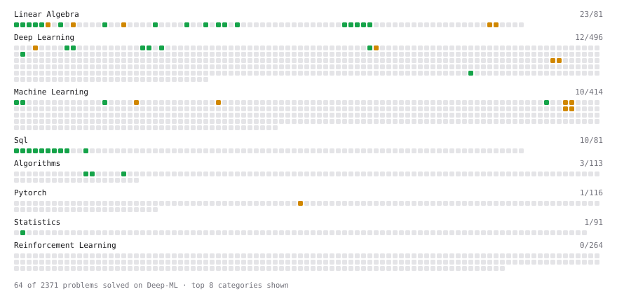

# Deep-ML

My machine learning practice from [Deep-ML](https://www.deep-ml.com). Every solution here was written by hand.

**82** solved · 53 problems · 0 labs · 29 math

[**Browse the interactive portfolio**](https://eduardoescamillasal.github.io/deep-ml/) to replay this filling in over time.

## Problems

| | Difficulty | Solved | |
| --- | --- | --- | --- |
| [Average per group](https://www.deep-ml.com/problems/1108) | easy | 2026-11-11 | [solution](problems/1108-average-per-group) |
| [Calculate 2x2 Matrix Inverse](https://www.deep-ml.com/problems/8) | easy | 2026-11-06 | [solution](problems/0008-calculate-2x2-matrix-inverse) |
| [Calculate Mean by Row or Column](https://www.deep-ml.com/problems/4) | easy | 2026-11-06 | [solution](problems/0004-calculate-mean-by-row-or-column) |
| [Compute the Cross Product of Two 3D Vectors](https://www.deep-ml.com/problems/118) | easy | 2026-11-08 | [solution](problems/0118-compute-the-cross-product-of-two-3d-vectors) |
| [Convert Vector to Diagonal Matrix](https://www.deep-ml.com/problems/35) | easy | 2026-11-08 | [solution](problems/0035-convert-vector-to-diagonal-matrix) |
| [Count rows per group](https://www.deep-ml.com/problems/1107) | easy | 2026-11-11 | [solution](problems/1107-count-rows-per-group) |
| [Count Words Appearing Exactly Once in Each of Two Lists](https://www.deep-ml.com/problems/1141) | easy | 2026-11-10 | [solution](problems/1141-count-words-appearing-exactly-once-in-each-of-two-lists) |
| [Delete Duplicate Emails Keeping One](https://www.deep-ml.com/problems/1112) | easy | 2026-11-12 | [solution](problems/1112-delete-duplicate-emails-keeping-one) |
| [Derivative of a Polynomial](https://www.deep-ml.com/problems/116) | easy | 2026-11-06 | [solution](problems/0116-derivative-of-a-polynomial) |
| [Descriptive Statistics Calculator](https://www.deep-ml.com/problems/78) | easy | 2026-11-09 | [solution](problems/0078-descriptive-statistics-calculator) |
| [Dot Product Calculator](https://www.deep-ml.com/problems/83) | easy | 2026-11-06 | [solution](problems/0083-dot-product-calculator) |
| [Filter rows with WHERE](https://www.deep-ml.com/problems/1103) | easy | 2026-11-11 | [solution](problems/1103-filter-rows-with-where) |
| [First N Fibonacci Numbers](https://www.deep-ml.com/problems/1151) | easy | 2026-11-10 | [solution](problems/1151-first-n-fibonacci-numbers) |
| [Forward Kinematics of a 2-Link Planar Arm](https://www.deep-ml.com/problems/1210) | easy | 2026-11-18 | [solution](problems/1210-forward-kinematics-of-a-2-link-planar-arm) |
| [Gradient Direction and Magnitude](https://www.deep-ml.com/problems/308) | easy | 2026-11-08 | [solution](problems/0308-gradient-direction-and-magnitude) |
| [Implement Orthogonal Projection of a Vector onto a Line](https://www.deep-ml.com/problems/66) | easy | 2026-11-06 | [solution](problems/0066-implement-orthogonal-projection-of-a-vector-onto-a-line) |
| [Implement ReLU Activation Function](https://www.deep-ml.com/problems/42) | easy | 2026-11-18 | [solution](problems/0042-implement-relu-activation-function) |
| [Leaky ReLU Activation Function](https://www.deep-ml.com/problems/44) | easy | 2026-11-18 | [solution](problems/0044-leaky-relu-activation-function) |
| [Linear Regression Using Gradient Descent](https://www.deep-ml.com/problems/15) | easy | 2026-11-06 | [solution](problems/0015-linear-regression-using-gradient-descent) |
| [Linear Regression Using Normal Equation](https://www.deep-ml.com/problems/14) | easy | 2026-11-06 | [solution](problems/0014-linear-regression-using-normal-equation) |
| [Matrix Determinant & Trace](https://www.deep-ml.com/problems/195) | easy | 2026-11-08 | [solution](problems/0195-matrix-determinant-trace) |
| [Matrix-Vector Dot Product](https://www.deep-ml.com/problems/1) | easy | 2026-11-05 | [solution](problems/0001-matrix-vector-dot-product) |
| [Remove duplicates with DISTINCT](https://www.deep-ml.com/problems/1105) | easy | 2026-11-11 | [solution](problems/1105-remove-duplicates-with-distinct) |
| [Reshape Matrix](https://www.deep-ml.com/problems/3) | easy | 2026-11-06 | [solution](problems/0003-reshape-matrix) |
| [Scalar Multiplication of a Matrix](https://www.deep-ml.com/problems/5) | easy | 2026-11-06 | [solution](problems/0005-scalar-multiplication-of-a-matrix) |
| [SELECT all rows](https://www.deep-ml.com/problems/1101) | easy | 2026-11-11 | [solution](problems/1101-select-all-rows) |
| [Select specific columns](https://www.deep-ml.com/problems/1102) | easy | 2026-11-11 | [solution](problems/1102-select-specific-columns) |
| [Sort results with ORDER BY](https://www.deep-ml.com/problems/1104) | easy | 2026-11-11 | [solution](problems/1104-sort-results-with-order-by) |
| [Tensor Puzzle: Extract the Diagonal](https://www.deep-ml.com/problems/1271) | easy | 2026-11-08 | [solution](problems/1271-tensor-puzzle-extract-the-diagonal) |
| [Tensor Puzzle: Identity Matrix from Comparisons](https://www.deep-ml.com/problems/1272) | easy | 2026-11-08 | [solution](problems/1272-tensor-puzzle-identity-matrix-from-comparisons) |
| [Tensor Puzzle: Ones Vector from First Principles](https://www.deep-ml.com/problems/1268) | easy | 2026-11-08 | [solution](problems/1268-tensor-puzzle-ones-vector-from-first-principles) |
| [Tensor Puzzle: Outer Product via Broadcasting](https://www.deep-ml.com/problems/1270) | easy | 2026-11-08 | [solution](problems/1270-tensor-puzzle-outer-product-via-broadcasting) |
| [Tensor Puzzle: Sum a Vector with a Dot Product](https://www.deep-ml.com/problems/1269) | easy | 2026-11-08 | [solution](problems/1269-tensor-puzzle-sum-a-vector-with-a-dot-product) |
| [Top N with LIMIT](https://www.deep-ml.com/problems/1106) | easy | 2026-11-11 | [solution](problems/1106-top-n-with-limit) |
| [Top-K Largest Elements in a List](https://www.deep-ml.com/problems/1137) | easy | 2026-11-10 | [solution](problems/1137-top-k-largest-elements-in-a-list) |
| [Transpose of a Matrix](https://www.deep-ml.com/problems/2) | easy | 2026-11-06 | [solution](problems/0002-transpose-of-a-matrix) |
| [Vector Element-wise Sum](https://www.deep-ml.com/problems/121) | easy | 2026-11-11 | [solution](problems/0121-vector-element-wise-sum) |
| [Vector Norms (L1/L2/L-inf) and the Frobenius Norm](https://www.deep-ml.com/problems/328) | easy | 2026-11-14 | [solution](problems/0328-vector-norms-l1-l2-l-inf-and-the-frobenius-norm) |
| [Your first JOIN](https://www.deep-ml.com/problems/1109) | easy | 2026-11-11 | [solution](problems/1109-your-first-join) |
| [2D Translation Matrix Implementation](https://www.deep-ml.com/problems/55) | medium | 2026-11-08 | [solution](problems/0055-2d-translation-matrix-implementation) |
| [Apply a 2D Convolution](https://www.deep-ml.com/problems/1233) | medium | 2026-11-17 | [solution](problems/1233-apply-a-2d-convolution) |
| [Calculate Eigenvalues of a Matrix](https://www.deep-ml.com/problems/6) | medium | 2026-11-06 | [solution](problems/0006-calculate-eigenvalues-of-a-matrix) |
| [Chain Rule for Composite Functions](https://www.deep-ml.com/problems/214) | medium | 2026-11-06 | [solution](problems/0214-chain-rule-for-composite-functions) |
| [Classify Critical Points Using Hessian Eigenvalues](https://www.deep-ml.com/problems/311) | medium | 2026-11-15 | [solution](problems/0311-classify-critical-points-using-hessian-eigenvalues) |
| [Compute the Hessian Matrix](https://www.deep-ml.com/problems/218) | medium | 2026-11-15 | [solution](problems/0218-compute-the-hessian-matrix) |
| [Implement Gradient Descent Variants with MSE Loss](https://www.deep-ml.com/problems/47) | medium | 2026-11-06 | [solution](problems/0047-implement-gradient-descent-variants-with-mse-loss) |
| [Linear Regression - Power Grid Optimization](https://www.deep-ml.com/problems/92) | medium | 2026-11-13 | [solution](problems/0092-linear-regression-power-grid-optimization) |
| [Mini-Batch Gradient Descent Step for Linear Regression](https://www.deep-ml.com/problems/803) | medium | 2026-11-18 | [solution](problems/0803-mini-batch-gradient-descent-step-for-linear-regression) |
| [Partial Derivatives of Multivariable Functions](https://www.deep-ml.com/problems/215) | medium | 2026-11-06 | [solution](problems/0215-partial-derivatives-of-multivariable-functions) |
| [Partitioned Inverse via Schur Complements](https://www.deep-ml.com/problems/1775) | medium | 2026-11-09 | [solution](problems/1775-partitioned-inverse-via-schur-complements) |
| [Solve Linear Equations using Jacobi Method](https://www.deep-ml.com/problems/11) | medium | 2026-11-18 | [solution](problems/0011-solve-linear-equations-using-jacobi-method) |
| [Stochastic Gradient Descent Step for Linear Regression](https://www.deep-ml.com/problems/802) | medium | 2026-11-08 | [solution](problems/0802-stochastic-gradient-descent-step-for-linear-regression) |
| [Woodbury, Sherman-Morrison and the Determinant Lemma](https://www.deep-ml.com/problems/1774) | medium | 2026-11-09 | [solution](problems/1774-woodbury-sherman-morrison-and-the-determinant-lemma) |

## Math

| | Difficulty | Solved | |
| --- | --- | --- | --- |
| [Derivatives and Gradients](https://www.deep-ml.com/math-problems/1) | easy | 2026-11-06 | [solution](math/0001-derivatives-and-gradients) |
| [Descriptive Statistics](https://www.deep-ml.com/math-problems/18) | easy | 2026-11-09 | [solution](math/0018-descriptive-statistics) |
| [Expectation and Variance Algebra](https://www.deep-ml.com/math-problems/33) | easy | 2026-11-11 | [solution](math/0033-expectation-and-variance-algebra) |
| [Gradient Descent Updates](https://www.deep-ml.com/math-problems/5) | easy | 2026-11-06 | [solution](math/0005-gradient-descent-updates) |
| [Matrix Basics](https://www.deep-ml.com/math-problems/9) | easy | 2026-11-06 | [solution](math/0009-matrix-basics) |
| [ML Workflow Basics](https://www.deep-ml.com/math-problems/30) | easy | 2026-11-09 | [solution](math/0030-ml-workflow-basics) |
| [Vector Operations](https://www.deep-ml.com/math-problems/7) | easy | 2026-11-06 | [solution](math/0007-vector-operations) |
| [Why Minibatches: Gradient Variance vs Batch Size](https://www.deep-ml.com/math-problems/130) | easy | 2026-11-08 | [solution](math/0130-why-minibatches-gradient-variance-vs-batch-size) |
| [Condition Numbers: Why the Determinant Lies About Near-Singularity](https://www.deep-ml.com/math-problems/412) | medium | 2026-11-13 | [solution](math/0412-condition-numbers-why-the-determinant-lies-about-near-singularity) |
| [Information Theory: Entropy](https://www.deep-ml.com/math-problems/24) | medium | 2026-11-10 | [solution](math/0024-information-theory-entropy) |
| [Inverse and Rank](https://www.deep-ml.com/math-problems/12) | medium | 2026-11-06 | [solution](math/0012-inverse-and-rank) |
| [Least Squares and the Normal Equations](https://www.deep-ml.com/math-problems/34) | medium | 2026-11-06 | [solution](math/0034-least-squares-and-the-normal-equations) |
| [Matrix Multiplication](https://www.deep-ml.com/math-problems/10) | medium | 2026-11-06 | [solution](math/0010-matrix-multiplication) |
| [Missing-Data Mechanisms: MCAR, MAR, NMAR and the Bias of Mean Imputation](https://www.deep-ml.com/math-problems/354) | medium | 2026-11-10 | [solution](math/0354-missing-data-mechanisms-mcar-mar-nmar-and-the-bias-of-mean-imputation) |
| [Multivariate Calculus](https://www.deep-ml.com/math-problems/2) | medium | 2026-11-06 | [solution](math/0002-multivariate-calculus) |
| [Optimization: Convexity and Critical Points](https://www.deep-ml.com/math-problems/6) | medium | 2026-11-14 | [solution](math/0006-optimization-convexity-and-critical-points) |
| [Orthogonality and Projections](https://www.deep-ml.com/math-problems/14) | medium | 2026-11-06 | [solution](math/0014-orthogonality-and-projections) |
| [Positive Definite Matrices and Quadratic Forms](https://www.deep-ml.com/math-problems/50) | medium | 2026-11-14 | [solution](math/0050-positive-definite-matrices-and-quadratic-forms) |
| [Schur Complements and the Partitioned Inverse](https://www.deep-ml.com/math-problems/409) | medium | 2026-11-06 | [solution](math/0409-schur-complements-and-the-partitioned-inverse) |
| [Softmax and Cross-Entropy](https://www.deep-ml.com/math-problems/32) | medium | 2026-11-16 | [solution](math/0032-softmax-and-cross-entropy) |
| [Solving Linear Systems](https://www.deep-ml.com/math-problems/13) | medium | 2026-11-06 | [solution](math/0013-solving-linear-systems) |
| [Statistical Inference](https://www.deep-ml.com/math-problems/27) | medium | 2026-11-08 | [solution](math/0027-statistical-inference) |
| [Subgradients, Lipschitz Smoothness and Strong Convexity](https://www.deep-ml.com/math-problems/418) | medium | 2026-11-15 | [solution](math/0418-subgradients-lipschitz-smoothness-and-strong-convexity) |
| [The Fourier Transform and the Convolution Theorem](https://www.deep-ml.com/math-problems/155) | medium | 2026-11-12 | [solution](math/0155-the-fourier-transform-and-the-convolution-theorem) |
| [Type I and Type II Error, Power, and the Uniform Null](https://www.deep-ml.com/math-problems/83) | medium | 2026-11-10 | [solution](math/0083-type-i-and-type-ii-error-power-and-the-uniform-null) |
| [Uniform Quantization: Scale and Zero-Point](https://www.deep-ml.com/math-problems/45) | medium | 2026-11-17 | [solution](math/0045-uniform-quantization-scale-and-zero-point) |
| [Vector Norms and Linear Independence](https://www.deep-ml.com/math-problems/8) | medium | 2026-11-11 | [solution](math/0008-vector-norms-and-linear-independence) |
| [Woodbury, Sherman-Morrison and the Matrix Determinant Lemma](https://www.deep-ml.com/math-problems/410) | medium | 2026-11-06 | [solution](math/0410-woodbury-sherman-morrison-and-the-matrix-determinant-lemma) |
| [Matrix Decompositions: LU and QR](https://www.deep-ml.com/math-problems/15) | hard | 2026-11-09 | [solution](math/0015-matrix-decompositions-lu-and-qr) |

---

_This file is regenerated by Deep-ML on every push._
